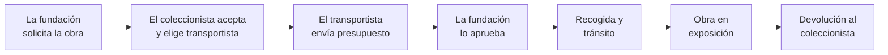

# PrestArte

**La red profesional para prestar obras de arte entre coleccionistas privados y fundaciones o museos.**

Muchas obras de colecciones privadas pasan años guardadas, mientras museos y fundaciones buscan piezas para sus exposiciones. Hoy un préstamo así se organiza con correos, llamadas y hojas de cálculo: quién tiene la obra, en qué condiciones se presta, quién la transporta, cuánto cuesta y dónde está en cada momento.

PrestArte junta todo eso en una sola plataforma. El coleccionista publica sus obras, la institución las solicita, una empresa de transporte especializada se encarga del envío y cada paso queda registrado, desde la solicitud hasta que la obra vuelve a casa.

---

## ¿Para quién es?

| Perfil | Qué hace en PrestArte |
|---|---|
| 🖼️ **Coleccionista** | Publica sus obras con fotos, medidas, estado de conservación, valor estimado y condiciones de préstamo. Adjunta certificados o seguros, y puede marcarlos como confidenciales. Recibe solicitudes, las acepta o rechaza y elige el transportista. |
| 🏛️ **Fundación / museo** | Busca en el catálogo, solicita préstamos para sus exposiciones, aprueba el presupuesto del transporte y sigue el envío hasta recibir la obra. |
| 🚚 **Empresa de transporte** | Tiene un perfil público con sus zonas de cobertura. Recibe los encargos, envía presupuesto (transporte y seguro) y va marcando la recogida, el tránsito y la entrega. |
| 🛡️ **Administración** | Revisa y aprueba cada cuenta nueva a partir de su documentación. Supervisa los préstamos y las conversaciones. |

Es una red **cerrada y verificada**: nadie opera sin que el equipo haya revisado antes su documentación (DNI, NIE o CIF y un documento acreditativo).

---

## Cómo funciona un préstamo



1. **Solicitud.** La fundación encuentra una obra en el catálogo público e indica las fechas y las condiciones del préstamo.
2. **Aceptación.** El coleccionista acepta y elige una empresa de transporte de confianza. Puede hacerla obligatoria o dejar que se cambie si el presupuesto no convence.
3. **Presupuesto.** El transportista propone precio, coste del seguro y valor asegurado. La fundación lo aprueba o lo rechaza, y en ese caso se pide un presupuesto nuevo.
4. **Envío.** El coleccionista marca la obra como lista para recoger, y el transportista registra la recogida, el tránsito y la entrega con número de seguimiento.
5. **Préstamo.** La obra queda expuesta en la institución.
6. **Devolución.** Al terminar, la fundación inicia la vuelta y se crea un envío de retorno con el mismo seguimiento.

El préstamo se puede cancelar mientras la obra no haya salido.

Cada préstamo sigue una **máquina de estados estricta**: no se puede saltar un paso ni retroceder a un estado no previsto, y cada acción solo la puede hacer la parte a la que le toca.

---

## Funcionalidades

- **Catálogo público** de obras disponibles, con fichas detalladas y galería de fotos. Se puede consultar sin cuenta.
- **Directorio de transportistas** con su perfil y zonas de cobertura.
- **Panel propio para cada perfil**, con estadísticas, solicitudes pendientes y préstamos activos.
- **Chat por préstamo** entre coleccionista, fundación y transportista, con imágenes y PDF adjuntos.
- **Contrato en PDF** generado automáticamente: un certificado de préstamo y cobertura de transporte con los datos de la obra, las partes, el envío y el seguro.
- **Documentación de cada obra** (certificados de autenticidad, pólizas, informes de estado), con opción de ocultarla al resto.
- **Notificaciones** en la aplicación cuando algo requiere tu atención.
- **Emails** de bienvenida, activación de cuenta y recuperación de contraseña.
- **Validaciones españolas**: comprueba la letra o el dígito de control de DNI, NIE y CIF, y el formato de los teléfonos.

## Seguridad y privacidad

- Autenticación con **JWT**, sin sesiones en el servidor, y contraseñas cifradas con **BCrypt**.
- **Permisos en cada operación**: solo el dueño de una obra puede editarla, y solo las partes de un préstamo pueden verlo o hablar en su chat.
- **Archivos protegidos**: los documentos de verificación, los adjuntos del chat y los documentos confidenciales solo los ven quienes tienen permiso.
- **Subidas validadas por contenido real**, no por la extensión: solo se aceptan imágenes y PDF.
- **Límite de intentos** en el inicio de sesión, el registro y la recuperación de contraseña.
- La recuperación de contraseña **no revela** si un email está registrado.

---

## Tecnologías

| Capa | Stack |
|---|---|
| **Frontend** | Angular 21 (componentes standalone, signals y carga diferida de rutas) y Tailwind CSS 4 |
| **Backend** | Java 21, Spring Boot 4, Spring Security, Spring Data JPA y Bean Validation |
| **Base de datos** | MySQL |
| **Otros** | JJWT (tokens), OpenPDF (contratos), Spring Mail (SMTP) y Lombok |

## Estructura del repositorio

```
PrestArte/
├── BackEnd/                 API REST (Spring Boot)
│   └── src/main/java/com/prestarte/tfg/
│       ├── controller/      Endpoints REST
│       ├── service/         Lógica de negocio
│       │   └── statemachine/  Ciclo de vida de préstamos y envíos
│       ├── model/           Entidades JPA y DTOs
│       ├── repository/      Acceso a datos
│       ├── security/        JWT, usuario actual y límite de intentos
│       └── config/          Seguridad, CORS y datos iniciales
├── FrontEnd/                Aplicación web (Angular)
│   └── src/app/
│       ├── core/            Servicios, modelos, guards e interceptores
│       ├── features/        Pantallas por perfil (admin, collector, foundation, transport…)
│       └── shared/          Componentes y pipes reutilizables
└── design/                  Prototipos de diseño de las pantallas
```

---

## Autor

**Sergio Fernández Morales.** Proyecto nacido como Trabajo de Fin de Grado de Desarrollo de Aplicaciones Web.
